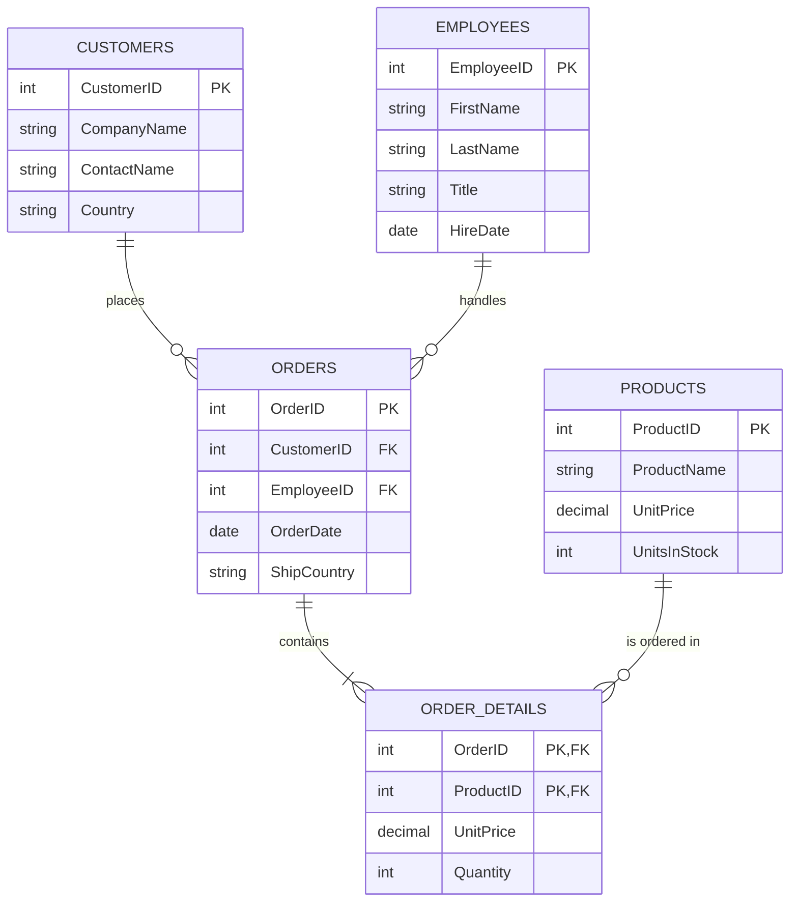

Task 4 – Entity-Relationship Diagram + SQL Schema
1. Entity-Relationship Diagram (ERD)
Below is a clear textual / Mermaid representation of a simplified Northwind-style schema covering the three core entities we will implement: Employees, Orders, and Customers (plus a linking concept for completeness).
You can copy the Mermaid code into https://mermaid.live or any Markdown viewer that supports Mermaid to see the visual diagram.  
Alternatively, open the diagram in draw.io / Figma / Canva and export a PNG into this folder.

Relationships explained
One Customer can place many Orders (1 : N)
One Employee can handle many Orders (1 : N)
One Order contains many Order Details lines (1 : N)
One Product can appear in many Order Details lines (1 : N)
---
2. SQL Schema – CREATE TABLE statements
At least three entities with Primary Keys, Foreign Keys, appropriate data types and NOT NULL constraints.
```sql
-- =============================================
-- 1. Customers
-- =============================================
CREATE TABLE Customers (
    CustomerID      INT             NOT NULL PRIMARY KEY,
    CompanyName     NVARCHAR(100)   NOT NULL,
    ContactName     NVARCHAR(50)    NULL,
    Country         NVARCHAR(50)    NULL
);

-- =============================================
-- 2. Employees
-- =============================================
CREATE TABLE Employees (
    EmployeeID      INT             NOT NULL PRIMARY KEY,
    FirstName       NVARCHAR(50)    NOT NULL,
    LastName        NVARCHAR(50)    NOT NULL,
    Title           NVARCHAR(50)    NULL,
    HireDate        DATE            NULL
);

-- =============================================
-- 3. Orders  (depends on Customers + Employees)
-- =============================================
CREATE TABLE Orders (
    OrderID         INT             NOT NULL PRIMARY KEY,
    CustomerID      INT             NOT NULL,
    EmployeeID      INT             NOT NULL,
    OrderDate       DATE            NOT NULL,
    ShipCountry     NVARCHAR(50)    NULL,

    -- Foreign Key constraints
    CONSTRAINT FK_Orders_Customers 
        FOREIGN KEY (CustomerID) REFERENCES Customers(CustomerID),

    CONSTRAINT FK_Orders_Employees 
        FOREIGN KEY (EmployeeID) REFERENCES Employees(EmployeeID)
);

-- =============================================
-- (Bonus) OrderDetails – shows a composite key + extra FK
-- =============================================
CREATE TABLE OrderDetails (
    OrderID         INT             NOT NULL,
    ProductID       INT             NOT NULL,
    UnitPrice       DECIMAL(10,2)   NOT NULL,
    Quantity        INT             NOT NULL CHECK (Quantity > 0),

    -- Composite Primary Key
    CONSTRAINT PK_OrderDetails PRIMARY KEY (OrderID, ProductID),

    -- Foreign Key back to Orders
    CONSTRAINT FK_OrderDetails_Orders 
        FOREIGN KEY (OrderID) REFERENCES Orders(OrderID)
);
```
```
Explanation of the SQL Schema:

1. Customers
   - CustomerID is the Primary Key (PK) and is NOT NULL.
   - CompanyName is required (NOT NULL) because every customer must have a name.
   - ContactName and Country are optional.

2. Employees
   - EmployeeID is the Primary Key.
   - FirstName and LastName are mandatory (NOT NULL) – matches the requirement from Task 2 that we work with first names.
   - Title and HireDate are optional.

3. Orders
   - OrderID is the Primary Key.
   - CustomerID and EmployeeID are Foreign Keys (FK) that reference the PKs of Customers and Employees.
   - Both FKs are declared NOT NULL so every order must belong to a real customer and a real employee.
   - OrderDate is required.
   - The two CONSTRAINT ... FOREIGN KEY clauses enforce referential integrity: you cannot insert an Order with a CustomerID or EmployeeID that does not exist.

4. OrderDetails (bonus entity)
   - Demonstrates a composite primary key (OrderID + ProductID).
   - Shows an additional Foreign Key relationship.
   - Includes a CHECK constraint to guarantee Quantity is positive.

These four tables form a realistic, normalized mini-schema that mirrors the real Northwind database structure used in Geek Week and in Task 2.
```
For submission, commit and push.
Place any exported ERD image (PNG/JPG) inside the Task 4 folder.
Keep this Task 4.md file with the SQL and explanations.